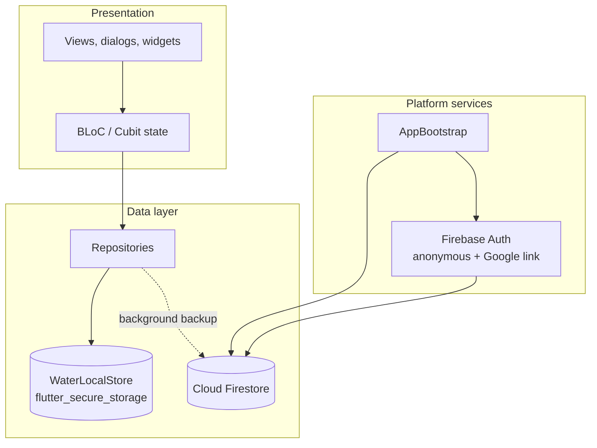
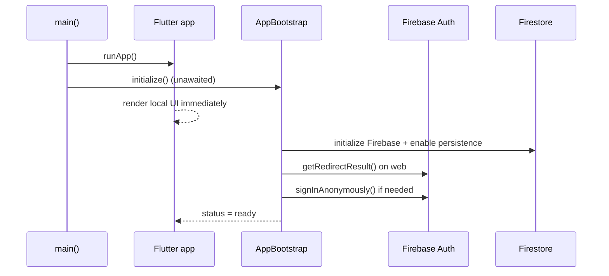
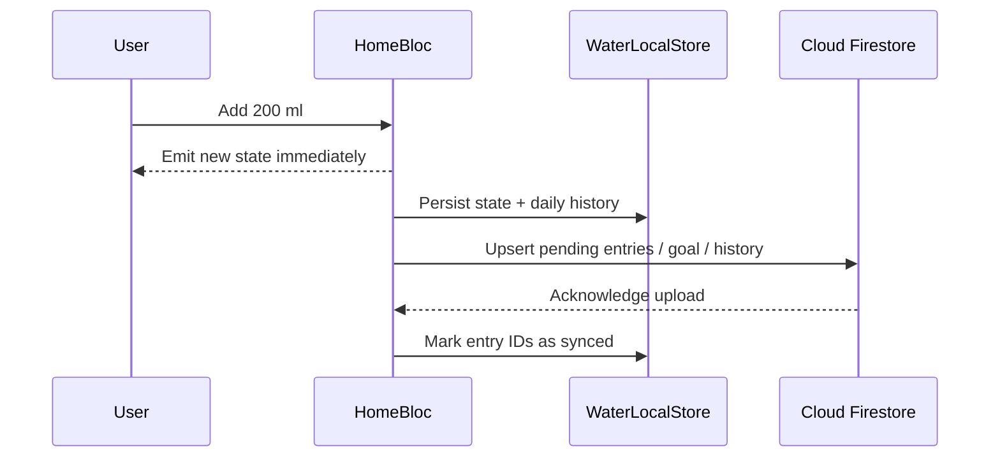
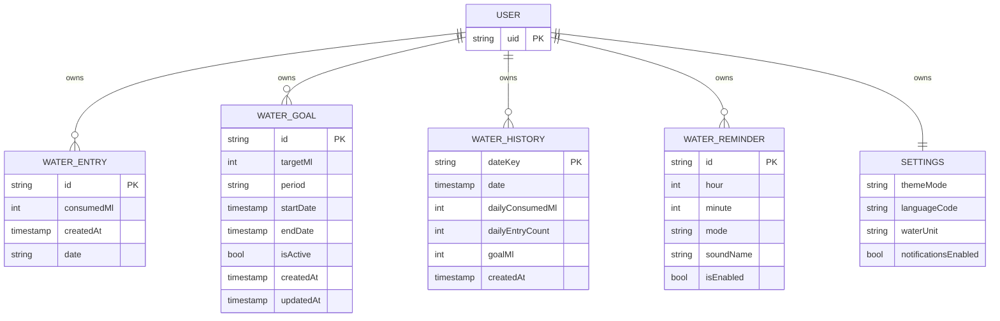

# Water Reminder

A cross-platform water tracking app built with Flutter, BLoC, and Firebase. Water Reminder is designed around an offline-first workflow: every action is reflected in the UI immediately and saved to local storage first, then backed up to Cloud Firestore in the background when a connection is available.


> The GIF is a scripted product demo. The Google account shown in the account chooser (`Demo User` / `demo.water@gmail.com`) is a sample account created for the recording. The demo does not contact Google and does not use real credentials.

## Table of Contents

- [Overview](#overview)
- [Features](#features)
- [Demo](#demo)
- [Tech Stack](#tech-stack)
- [Architecture](#architecture)
- [Offline-First Data Flow](#offline-first-data-flow)
- [Authentication](#authentication)
- [Firestore Data Model](#firestore-data-model)
- [Firestore Security Rules](#firestore-security-rules)
- [Local Storage](#local-storage)
- [Project Structure](#project-structure)
- [Setup](#setup)
- [Running the App](#running-the-app)
- [Building for Production](#building-for-production)
- [Platform Notes](#platform-notes)
- [Troubleshooting](#troubleshooting)
- [Current Scope and Extension Points](#current-scope-and-extension-points)
- [License](#license)

## Overview

Water Reminder helps users track daily water intake against a configurable goal. The app supports Android and web, uses silent anonymous authentication by default, and lets users optionally connect a Google account from Settings.

The application is intentionally local-first:

- The UI never waits for Firestore to render a water entry or goal change.
- Local state is persisted with `flutter_secure_storage`.
- Firestore is used as a background backup and cross-device history layer.
- Firebase initialization happens after `runApp`, so the app can start even before Firebase is ready.
- There is no login screen. Anonymous authentication happens silently, and Google linking is an optional action in Settings.

## Features

- Daily hydration dashboard with a progress ring, consumed amount, goal, remaining amount, and completion percentage.
- Quick add `200 ml` and a custom-amount dialog.
- Editable daily goal, with `2000 ml` as the default.
- Today's water entries with timestamps.
- History view for the last 7 or 30 days, including total intake, daily average, entry count, active-day count, and daily records.
- Water unit switch between milliliters (`ml`) and fluid ounces (`oz`).
- Theme selection: system, light, or dark.
- Language preference selector: Türkçe or English.
- Notification master switch and reminder configuration with time, sound/vibration/silent mode, and enabled state.
- Optional Google account linking from Settings.
- Offline-first persistence and background Firestore backup.
- Responsive Material 3 interface for Android and web.

## Demo

The demo GIF above shows the main product flow:

1. A new day starts at `0 / 2000 ml`.
2. Three quick-add actions add `200 ml` each.
3. The dashboard reaches `600 ml` and `30%`.
4. Today's entries are shown.
5. The History view summarizes the last 7 days.
6. Settings demonstrates the `ml` / `oz` unit switch.
7. A sample Google account is connected to explain the backup flow.
8. The backup overlay shows local-first saving and Firestore synchronization.
9. The app returns to the dashboard and ends with the daily summary.

The Google and backup segment is a visual simulation for demonstration purposes. The production Google flow is implemented in `lib/blocs/auth/auth_service.dart` and is described in [Authentication](#authentication).

## Tech Stack

| Area | Technology |
| --- | --- |
| Framework | Flutter 3.41.6 / Dart 3.11.4 |
| Language | Dart |
| UI | Material 3, custom gradients, shader-mask text, responsive layouts |
| State management | `flutter_bloc` 9.1.1, `equatable` 2.0.8 |
| Local persistence | `flutter_secure_storage` 10.1.0 |
| Authentication | Firebase Authentication 6.5.2 (anonymous + Google) |
| Cloud database | Cloud Firestore 6.5.0 |
| Firebase core | `firebase_core` 4.10.0 |
| Typography | `google_fonts` 8.1.0, `font_awesome_flutter` 11.0.0, `fluttericon` 2.0.0 |
| Formatting | `intl` 0.20.2 |
| Linting | `flutter_lints` 6.0.0 |
| Developer testing tools | `bloc_test` 10.0.0, `flutter_test` |
| Platforms | Android, Web |

`firebase_crashlytics` is declared in `pubspec.yaml`, but it is not initialized by the current `AppBootstrap`.

## Architecture



### Layers

- **Presentation**: `HomeView`, `HistoryView`, `SettingsView`, `BottomTabbarView`, and dialogs such as `AddWaterDialog` and `EditGoalDialog`.
- **State**: `HomeBloc`, `HistoryBloc`, `SettingsCubit`, `AuthCubit`, `AddWaterCubit`, `EditGoalCubit`, and `TabbarCubit`. All UI state changes go through BLoC/Cubit; there is no `setState`.
- **Data**: `HomeRepository`, `HistoryRepository`, `SettingsRepository`, `FirestoreRepository`, and `WaterLocalStore`.
- **Platform**: `AppBootstrap` initializes Firebase and Firestore persistence, completes a pending web redirect result, and performs silent anonymous authentication.
- **Wiring**: `AppProviders` creates repositories and provides the BLoCs/Cubits to the widget tree.

### Startup sequence



`main()` does not await Firebase. `AppBootstrap` runs in the background and exposes a `ValueNotifier<BootstrapStatus>` with `loading`, `ready`, and `offline` states. BLoCs listen for readiness and retry on demand when a network operation needs Firebase.

## Offline-First Data Flow

### Write path



1. The user action is handled by `HomeBloc`.
2. A new in-memory entry is created with a local ID (`local_<microseconds>_<random>`).
3. The new state is emitted immediately, so the dashboard updates without waiting for the network.
4. The state and today's history summary are queued for local persistence in `WaterLocalStore`.
5. A background backup uploads only entries that are not yet in `syncedEntryIds`, the goal if `goalDirty` is set, and the current history summary.
6. Uploaded entry IDs are added to `syncedEntryIds` and persisted locally, which makes retries idempotent.
7. If the network fails, the local state remains authoritative and the backup is retried on the next action or refresh.

### Read path

1. `HomeBloc` loads local entries, the active goal, and local history.
2. The UI renders the local snapshot immediately.
3. When Firebase is ready, `HomeBloc` fetches today's remote entries and the active remote goal.
4. Remote entries are merged by document ID. Existing local entries win, and remote entries fill gaps.
5. If the local goal has unsaved changes (`goalDirty`), the local goal wins; otherwise the remote goal is adopted.
6. `HistoryBloc` applies the same pattern: local range first, then remote history merged into local storage.

### Consistency details

- Local entry IDs are reused as Firestore document IDs, so retrying an upload writes to the same document instead of creating duplicates.
- `_syncedEntryIds` is persisted in the local state and restored on startup.
- `_goalRevision` guards against an older in-flight goal upload clearing a newer local goal change.
- `_backupCurrent()` coalesces overlapping backup requests and serializes them with the local persistence queue.
- Network operations use 10–12 second timeouts; failures are logged and do not block local UI updates.
- Firestore persistence is enabled with unlimited cache. On web, `WebPersistentMultipleTabManager` is used so multiple tabs share the persistent cache safely.

## Authentication

Water Reminder does not show a login screen.

### Anonymous session

- On startup, `AppBootstrap` ensures a Firebase user exists.
- If no user is present, it calls `signInAnonymously()`.
- The anonymous user owns the `users/{uid}` data tree and can use the app immediately.

### Google linking

Google linking is available only from **Settings → Account → Connect Google**.

- A `GoogleAuthProvider` is configured with `prompt: select_account`, so the account chooser is shown.
- If the current user is already a non-anonymous Google user, the app returns the existing account without starting another flow.
- If the current user is anonymous, the Google account is linked to the anonymous user, preserving the existing data tree.

### Web flow

1. Try `signInWithPopup()` when there is no current user, or `linkWithPopup()` when the user is anonymous.
2. If the popup fails because of browser storage or opener restrictions, fall back to redirect.
3. Redirect fallback uses `signInWithRedirect()` or `linkWithRedirect()`.
4. After the browser returns, `AppBootstrap` calls `getRedirectResult()` exactly once, before anonymous sign-in, and records the result for `AuthCubit`.

The redirect fallback handles popup failures such as:

- `missing initial state`
- `sessionStorage` access failures
- `Cross-Origin-Opener-Policy` / `window.closed` restrictions
- `popup-blocked`
- `operation-not-supported-in-this-environment`
- `web-storage-unsupported`
- `internal-error`

### Android flow

Android uses the native Firebase Auth provider flow, not the web popup:

1. Ensure a current user exists; create an anonymous user if needed.
2. If the user is already non-anonymous, return the existing account.
3. Otherwise call `linkWithProvider()` to link the Google account.
4. If the credential or email is already in use, fall back to `signInWithProvider()`.
5. No popup or redirect code runs on Android.

### Auth state

`AuthCubit` listens to both `AppBootstrap.status` and `FirebaseAuth.authStateChanges()`. It exposes `AuthState` with the current user, loading state, error message, success message, and derived flags such as `isAnonymous` and `isGoogleConnected`.

## Firestore Data Model

All user data lives under a single owner document:

```text
users/{uid}
├── waterEntries/{entryId}
├── waterGoals/{goalId}
├── waterHistory/{dateKey}
├── waterReminders/{reminderId}
└── settings/preferences
```

The `users/{uid}` parent document itself is not written by the client. Security rules deny direct read/write on the parent and allow access only to the owner's subcollections.



### Collection details

| Path | Fields | Notes |
| --- | --- | --- |
| `users/{uid}/waterEntries/{entryId}` | `consumedMl` (int), `createdAt` (timestamp), `date` (string, `YYYY-MM-DD`) | Backed up by `HomeBloc`. Document ID is the local entry ID. |
| `users/{uid}/waterGoals/{goalId}` | `targetMl` (int), `period` (`daily` / `weekly` / `monthly`), `startDate` (timestamp), `endDate` (timestamp or null), `isActive` (bool), `createdAt` (timestamp), `updatedAt` (timestamp or null) | The current client uses daily goals. |
| `users/{uid}/waterHistory/{dateKey}` | `date` (timestamp), `dateKey` (string, `YYYY-MM-DD`), `dailyConsumedMl` (int), `dailyEntryCount` (int), `goalMl` (int), `createdAt` (timestamp) | Document ID must equal `dateKey`. Today's summary is written by `HomeBloc`. |
| `users/{uid}/waterReminders/{reminderId}` | `hour` (int), `minute` (int), `mode` (`sound` / `vibration` / `silent`), `soundName` (string), `isEnabled` (bool) | Schema and rules exist; the current client stores reminders locally. |
| `users/{uid}/settings/preferences` | `themeMode` (`system` / `light` / `dark`), `languageCode` (string), `waterUnit` (`ml` / `oz`), `notificationsEnabled` (bool) | Schema and rules exist; the current client stores settings locally. |

`firestore.indexes.json` currently contains no composite indexes. The implemented queries use simple equality filters and a single range/orderBy query on `waterHistory.date`.

## Firestore Security Rules

The deployed rules in [`firestore.rules`](firestore.rules) enforce:

- Authentication is required for every subcollection operation.
- `request.auth.uid` must match the `{userId}` path segment.
- The parent `users/{uid}` document cannot be read or written directly.
- Each collection has an explicit field allowlist and strict type/range validation.
- `waterEntries` require a positive `consumedMl`, a timestamp `createdAt`, and a valid `YYYY-MM-DD` date string.
- `waterGoals` require a positive target, a valid period, valid timestamps, and logical start/end dates.
- `waterHistory` requires non-negative totals, a positive goal, and a document ID equal to its `dateKey`.
- `waterReminders` require valid hour/minute ranges and a valid mode.
- `settings/preferences` requires valid theme, language length, unit, and notification values.

Deploy the rules and indexes with:

```bash
firebase deploy --only firestore:rules,firestore:indexes
```

## Local Storage

Local persistence is implemented by `LocalStorageManager` and `WaterLocalStore` on top of `flutter_secure_storage`.

| Key | Contents |
| --- | --- |
| `water_state_today` | JSON object with `date`, `entries`, `goal`, `syncedEntryIds`, and `goalDirty`. |
| `water_local_history` | JSON array of daily history summaries, capped at 365 days. |
| `app_settings` | JSON object with theme, language, water unit, and notification preference. |
| `water_reminders` | JSON array of reminder configurations. |

The daily state is keyed by the local date. When the stored date differs from today, entries are reset for the new day while the goal and its dirty flag are retained. History and all local writes are serialized through a queue to avoid overlapping writes.

## Project Structure

```text
flutter_water_reminder_app/
├── android/                         # Android host project and Firebase config (ignored)
├── assets/                          # Existing image assets
├── docs/
│   └── water_reminder_web_demo.gif  # Combined product demo
├── lib/
│   ├── blocs/
│   │   ├── add_water/               # Custom-amount dialog state
│   │   ├── auth/                    # Auth service, cubit, state
│   │   ├── edit_goal/               # Goal editing state
│   │   ├── history/                 # History bloc, repository, state
│   │   ├── home/                    # Home bloc, repository, state
│   │   ├── settings/                # Settings cubit, repository, state
│   │   ├── tabbar/                  # Bottom navigation state
│   │   ├── app_providers.dart       # Repository and BLoC wiring
│   │   └── firestore_repository.dart
│   ├── core/
│   │   ├── bootstrap/               # Firebase startup and redirect completion
│   │   ├── constants/               # Colors, gradients, constants
│   │   ├── extensions/              # Context extensions
│   │   ├── lifecycle/               # App lifecycle handling
│   │   ├── local_storage/           # Secure storage and water local store
│   │   ├── navigation/              # Navigation service and routes
│   │   └── utils/                   # Water formatting helpers
│   ├── models/
│   │   ├── app_settings.dart
│   │   └── water/                   # Entry, goal, history, reminder
│   ├── views/                       # Home, History, Settings
│   ├── widgets/                     # Dialogs, gradients, tab bar
│   ├── firebase_options.dart        # Generated local config (ignored)
│   └── main.dart                    # Immediate runApp + background bootstrap
├── web/                             # Web host project
├── firebase.json                    # Firestore rules/indexes configuration
├── firestore.rules                  # Deployed security rules
├── firestore.indexes.json           # Firestore indexes (currently empty)
├── pubspec.yaml
└── README.md
```

## Setup

### Prerequisites

- Flutter `3.41.6` or newer with Dart `3.11.4` or newer.
- Chrome for web development.
- Android Studio / Android SDK for Android development.
- Firebase CLI (`firebase`) and FlutterFire CLI (`flutterfire`).
- A Firebase project with Authentication and Cloud Firestore enabled.

### 1. Install dependencies

```bash
flutter pub get
```

### 2. Configure Firebase

The repository intentionally excludes local Firebase configuration:

- `lib/firebase_options.dart`
- `android/app/google-services.json`

Generate them for your own Firebase project:

```bash
firebase login
flutterfire configure --project=en-flutter-water-reminder
```

`flutterfire configure` writes the platform options and Android Google Services file. If you use a different Firebase project, replace the project ID and update `.firebaserc`.

### 3. Enable authentication providers

In **Firebase Console → Authentication → Sign-in method**:

1. Enable **Anonymous**.
2. Enable **Google** and configure the OAuth consent screen.
3. Add authorized domains for web deployments. `localhost` is available by default for local development.

### 4. Deploy Firestore rules and indexes

```bash
firebase deploy --only firestore:rules,firestore:indexes
```

### 5. Register Android signing fingerprints

Google sign-in on Android requires the app's package name and signing certificate fingerprints.

- Package name: `com.yuksi.flutter.water.reminder`
- Add the debug SHA-1 and SHA-256 while developing.
- Add the release SHA-1 and SHA-256 before testing a release build.

Fingerprints are added in **Firebase Console → Project settings → Your apps → Android app → SHA certificate fingerprints**.

### 6. Run the app

```bash
flutter devices
flutter run -d chrome
flutter run -d <android-device-id>
```

## Running the App

### Web

```bash
flutter run -d chrome
```

The web flow uses popup-first Google authentication and automatically falls back to redirect if the browser blocks the popup or its storage/opener access. After a redirect, `AppBootstrap` completes the result before anonymous sign-in.

### Android

```bash
flutter run -d <android-device-id>
```

Android uses the native Firebase Auth provider flow. No web popup code runs on Android.

## Building for Production

### Web

```bash
flutter build web --release
```

Deploy the contents of `build/web` to a static host. Add the production domain to **Firebase Console → Authentication → Settings → Authorized domains**.

### Android

```bash
flutter build appbundle --release
```

Before testing Google sign-in in a release build, add the release SHA-1 and SHA-256 to the Firebase Android app.

## Platform Notes

### Web authentication

- Popup sign-in is attempted first because it keeps the user on the same tab.
- Redirect fallback handles storage-partitioned browsers, COOP restrictions, and popup blockers.
- `getRedirectResult()` is called once in `AppBootstrap`, avoiding duplicate completion paths.
- The app must be served from an authorized domain. Local development normally uses `localhost`.
- If a browser blocks third-party storage or clears `sessionStorage`, the redirect flow may still require a normal browser session.

### Android authentication

- Google linking requires the correct package name and SHA fingerprints.
- The package name is `com.yuksi.flutter.water.reminder`.
- The app uses `linkWithProvider()` for anonymous users and `signInWithProvider()` only as a conflict fallback.
- If an Android build still references an old package, run `flutter clean` and rebuild.

### Offline behavior

- Local data remains available when Firebase is offline.
- Firestore persistence uses unlimited cache.
- Background backups are best-effort and retry on the next action or refresh.
- The app does not block startup on Firebase initialization.

## Troubleshooting

### `missing initial state` or COOP popup errors on web

The app should fall back to redirect automatically. If the error persists:

- Confirm the app is served from an authorized Firebase Auth domain.
- Confirm cookies and site storage are enabled for the origin.
- Avoid private windows or storage-partitioned browser modes.
- Fully reload the page after a redirect.
- Check that only `AppBootstrap` calls `getRedirectResult()`.

### Google linking fails on Android

- Confirm the package name is `com.yuksi.flutter.water.reminder`.
- Confirm the debug/release SHA-1 and SHA-256 are registered in Firebase.
- Confirm the Google provider is enabled.
- Confirm the OAuth consent screen is configured.
- Run `flutter clean` after changing the Android package or Firebase config.

### `permission-denied` from Firestore

- Confirm the user is signed in, including anonymous sign-in.
- Confirm the rules are deployed to the correct Firebase project.
- Confirm the document path starts with the current user's UID.
- Check that every required field is present and has the expected type.

### The app starts with a blank screen

- Check the browser/Android console for Firebase initialization errors.
- Confirm `lib/firebase_options.dart` and `android/app/google-services.json` exist for the current project.
- The local UI should still start while Firebase is loading; if it does not, inspect `AppBootstrap` logs.
- Run `flutter clean` and rebuild if platform configuration changed.

### Firestore writes are delayed

- This is expected in offline-first mode. Local state is saved first and the backup runs in the background.
- Check the console for `Home backup failed` or timeout messages.
- Verify network access and Firestore rules.

## Current Scope and Extension Points

- Firestore backup currently covers water entries, the active goal, and daily history summaries.
- Settings and reminder configurations are persisted locally; the Firestore paths and rules are already defined for future synchronization.
- Reminder times and notification preferences are stored, but OS-level notification scheduling is not wired in this build.
- The language preference is persisted; runtime localization is a future extension.
- `firebase_crashlytics` is available as a dependency but is not initialized.
- Release signing fingerprints must be added to Firebase before release Google sign-in testing.

## License

No license file is included in this repository. Add a license before redistributing the project.
